# Informe — Ejercicio 1: API REST en EC2 con base de datos RDS

**Universidad San Francisco Xavier de Chuquisaca**
**Materia:** Trabajando en la Nube (COM610)
**Evaluación:** Segundo examen parcial — Tema 4
**Docente:** Ing. Marcelo Quispe Ortega
**Estudiante:** Miranda Pereyra Williams
**GitHub:** [Williams4929](https://github.com/Williams4929)
**Semestre:** 2/2026

---

## 1. Objetivo

Implementar una API REST pública para gestionar un catálogo de **libros**. La API se ejecuta en **Amazon EC2** y guarda los datos en **Amazon RDS for MySQL**. Se publica mediante **Nginx** como proxy inverso en el puerto 80, y la base de datos no tiene acceso público.

**URL pública de la API:** `http://18.219.123.7`

---

## 2. Arquitectura

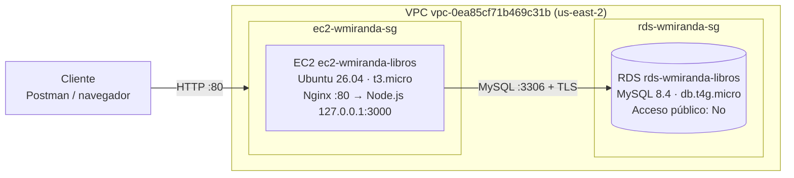

Flujo de una petición:

1. El cliente envía la petición HTTP a la Elastic IP `18.219.123.7`, puerto 80.
2. **Nginx** la recibe y la reenvía a la API Node.js, que solo escucha en `127.0.0.1:3000`.
3. La API consulta **RDS** por el puerto 3306, dentro de la VPC, con una conexión cifrada (TLS).
4. RDS solo acepta conexiones que provienen del grupo de seguridad de la EC2.

---

## 3. Recursos de AWS utilizados

Todos los recursos se crearon en la región **us-east-2 (Ohio)**, dentro de la misma VPC, y se identificaron con `wmiranda`.

| Recurso | Nombre / ID | Configuración |
|---|---|---|
| VPC | `vpc-0ea85cf71b469c31b` | VPC predeterminada; contiene EC2 y RDS |
| Instancia EC2 | `ec2-wmiranda-libros` (`i-0c716f3c575ad35db`) | Ubuntu Server 26.04 LTS, `t3.micro` |
| Elastic IP | `18.219.123.7` | Asociada a la EC2 para tener una URL estable |
| Par de claves | `wmiranda-key` | Archivo `.pem` guardado fuera del repositorio |
| Base de datos RDS | `rds-wmiranda-libros` | MySQL 8.4, `db.t4g.micro`, 20 GB, **acceso público deshabilitado** |
| Grupo de seguridad EC2 | `ec2-wmiranda-sg` (`sg-062f9bdb61702b432`) | SSH 22 desde mi IP, HTTP 80 desde Internet |
| Grupo de seguridad RDS | `rds-wmiranda-sg` (`sg-0cd093a9054a2d05f`) | MySQL 3306 solo desde `ec2-wmiranda-sg` |

---

## 4. Grupos de seguridad

### 4.1 Grupo de la EC2 — `ec2-wmiranda-sg`

| Tipo | Puerto | Origen | Motivo |
|---|---:|---|---|
| SSH | 22 | Mi IP pública (`/32`) | Administración, solo desde mi equipo |
| HTTP | 80 | `0.0.0.0/0` | Acceso público a la API mediante Nginx |

No hay reglas para los puertos **3000** (Node.js) ni **3306** (MySQL). La API no se expone directamente a Internet.

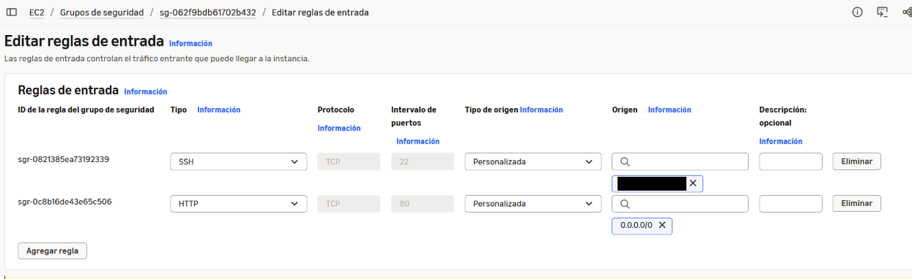

### 4.2 Grupo de RDS — `rds-wmiranda-sg`

| Tipo | Puerto | Origen |
|---|---:|---|
| MYSQL/Aurora | 3306 | Grupo de seguridad `ec2-wmiranda-sg` (`sg-062f9bdb61702b432`) |

El origen es el **ID del grupo de seguridad de la EC2**, no una dirección IP ni `0.0.0.0/0`. Así, solo las instancias de ese grupo pueden conectarse a la base de datos.

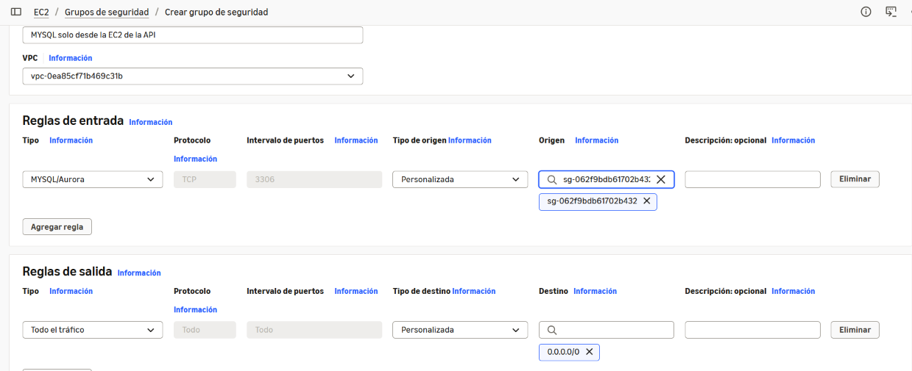

---

## 5. Instancia EC2

Se lanzó la instancia `ec2-wmiranda-libros` con Ubuntu 26.04 LTS, tipo `t3.micro`, en la VPC predeterminada y asociada al grupo `ec2-wmiranda-sg`. Para que la URL pública no cambie al detener e iniciar la instancia, se le asignó una **Elastic IP**.

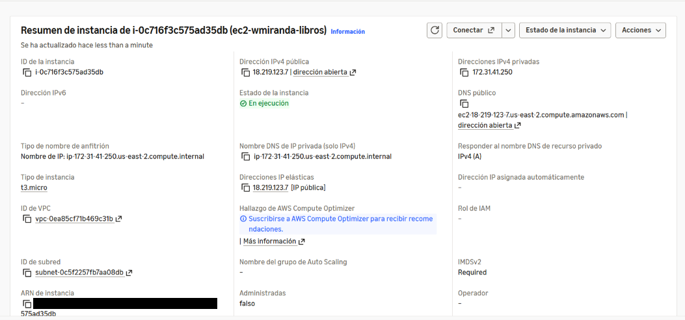

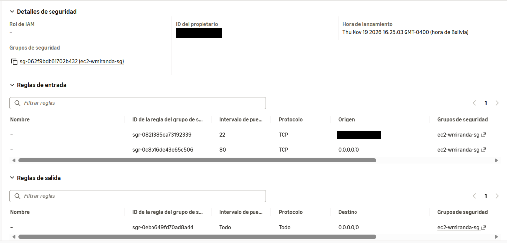

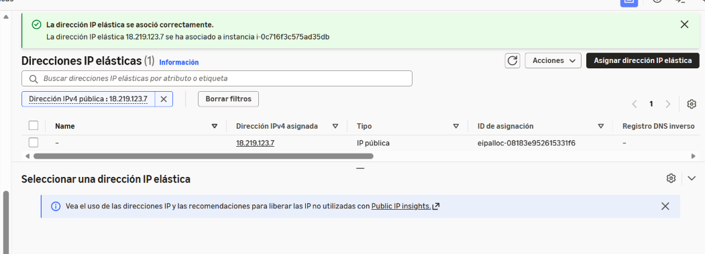

Conexión por SSH con el par de claves:

```bash
ssh -i wmiranda-key.pem ubuntu@18.219.123.7
```

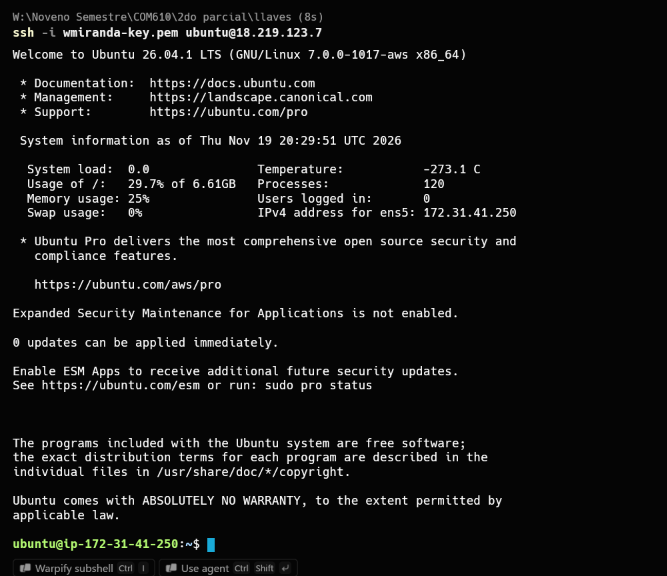

Software instalado en la instancia:

```bash
sudo apt update && sudo apt upgrade -y
sudo apt install -y nginx git mariadb-client nodejs npm
sudo npm install -g pm2
```

---

## 6. Base de datos RDS

Se creó la instancia `rds-wmiranda-libros` (MySQL 8.4, `db.t4g.micro`) en la misma VPC que la EC2, con **acceso público deshabilitado** y asociada solo al grupo `rds-wmiranda-sg`. En la consola, esto se ve como **"Puerta de enlace a Internet: Desactivado"**.

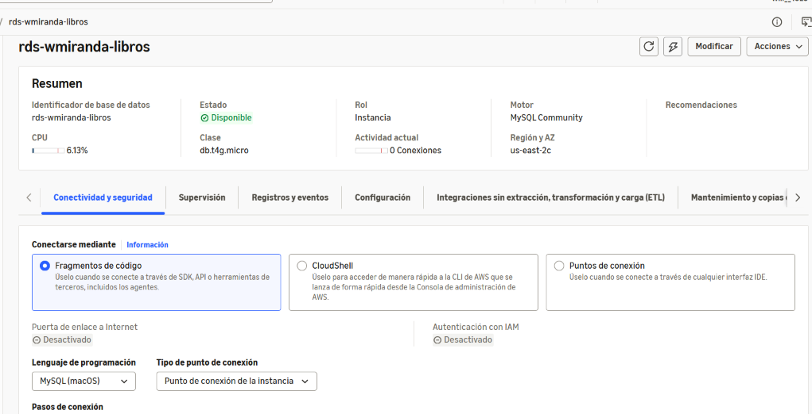

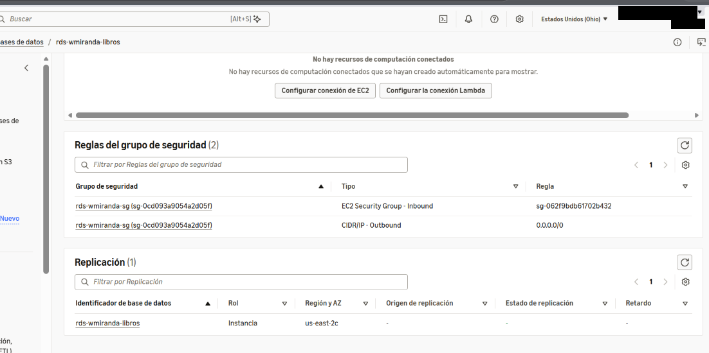

### 6.1 Conexión privada y cifrada desde EC2

RDS exige verificar su certificado TLS. Por eso se descargó el paquete de certificados de AWS en la EC2 y se usó en la conexión:

```bash
mkdir -p ~/certs
curl -o ~/certs/global-bundle.pem https://truststore.pki.rds.amazonaws.com/global/global-bundle.pem
mariadb -h <ENDPOINT_RDS> -P 3306 -u admin -p --ssl-ca=$HOME/certs/global-bundle.pem
```

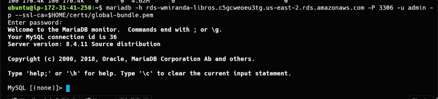

### 6.2 Modelo de datos — `db.sql`

El archivo [`db.sql`](db.sql) del repositorio crea la base de datos, la tabla `libros` y los registros iniciales:

```sql
CREATE DATABASE IF NOT EXISTS db_libros
  CHARACTER SET utf8mb4 COLLATE utf8mb4_unicode_ci;

USE db_libros;

CREATE TABLE IF NOT EXISTS libros (
  id INT AUTO_INCREMENT PRIMARY KEY,
  titulo VARCHAR(200) NOT NULL,
  autor VARCHAR(150) NOT NULL,
  anio_publicacion INT NOT NULL
);
```

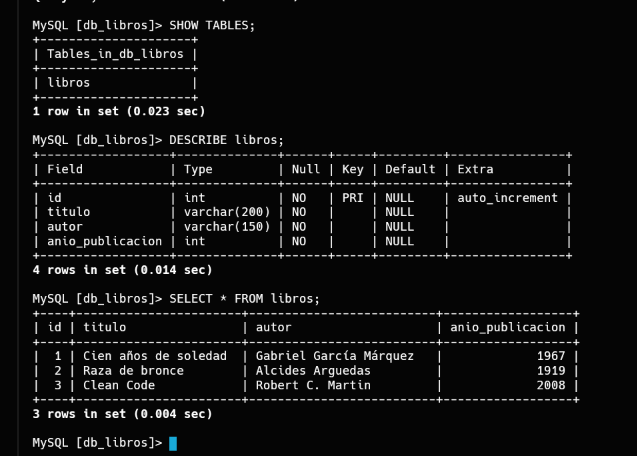

### 6.3 Usuario exclusivo para la API

En lugar del usuario maestro `admin`, la API usa un usuario que solo tiene los permisos necesarios sobre `db_libros`:

```sql
CREATE USER 'usr_libros'@'%' IDENTIFIED BY '********';
GRANT SELECT, INSERT, UPDATE, DELETE ON db_libros.* TO 'usr_libros'@'%';
FLUSH PRIVILEGES;
```

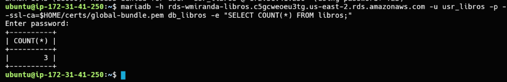

---

## 7. API REST con Node.js y Express

### 7.1 Estructura del proyecto

```
src/
  app.js               Rutas, códigos HTTP y manejo de errores
  validacion.js        Validación de titulo, autor y anio_publicacion
  librosRepository.js  Consultas SQL parametrizadas (capa de datos)
  db.js                Pool de conexiones mysql2 con variables de entorno y TLS
  server.js            Carga .env y arranca el servidor
db.sql                 Script de creación de la tabla
.env.example           Variables de entorno con valores ficticios
```

La aplicación se construye con `createApp(repo)`, que recibe la capa de datos como parámetro. Así se separa la lógica HTTP del acceso a la base de datos.

### 7.2 Endpoints

| Método y ruta | Respuesta correcta | Errores |
|---|---|---|
| `GET /health` | `200` `{"status":"ok","servicio":"api-libros","version":"1.0.0"}` | — |
| `GET /libros` | `200` con la lista de libros | — |
| `GET /libros/:id` | `200` con el libro | `404` si no existe, `400` si el id no es válido |
| `POST /libros` | `201` con el libro creado | `400` si los datos no son válidos |
| `PUT /libros/:id` | `200` con el libro actualizado | `404` si no existe, `400` si los datos no son válidos |
| `DELETE /libros/:id` | `200` `{"mensaje":"Libro N eliminado"}` | `404` si no existe |

### 7.3 Validaciones

- `titulo`: obligatorio, no vacío, máximo 200 caracteres.
- `autor`: obligatorio, no vacío, máximo 150 caracteres.
- `anio_publicacion`: entero entre 1 y el año actual.
- Si el cuerpo no es un JSON válido, la API responde `400`.

### 7.4 Consultas parametrizadas

Todas las operaciones SQL usan marcadores `?`, lo que evita la inyección SQL. Por ejemplo:

```js
await pool.execute(
  'INSERT INTO libros (titulo, autor, anio_publicacion) VALUES (?, ?, ?)',
  [titulo, autor, anio_publicacion]
);
```

### 7.5 Variables de entorno

La conexión a RDS se configura con variables de entorno. El archivo `.env` real solo existe en la EC2 y está excluido del repositorio mediante `.gitignore`. En el repositorio solo se publica [`.env.example`](.env.example), con valores ficticios:

```dotenv
PORT=3000
HOST=127.0.0.1
DB_HOST=tu-endpoint-rds.xxxxxxxx.us-east-2.rds.amazonaws.com
DB_PORT=3306
DB_USER=usr_libros
DB_PASSWORD=cambiar_esta_contrasena
DB_NAME=db_libros
DB_SSL_CA=/home/ubuntu/certs/global-bundle.pem
```

`HOST=127.0.0.1` hace que la API escuche solo en la propia instancia, de modo que únicamente Nginx puede reenviarle tráfico.

---

## 8. Despliegue en EC2

```bash
git clone https://github.com/Williams4929/com610-2do-Parcial.git
cd com610-2do-Parcial
cp .env.example .env   # completar con el endpoint y la contraseña reales
npm ci
pm2 start src/server.js --name api-libros
pm2 save
pm2 startup            # para que la API arranque sola al reiniciar la instancia
```

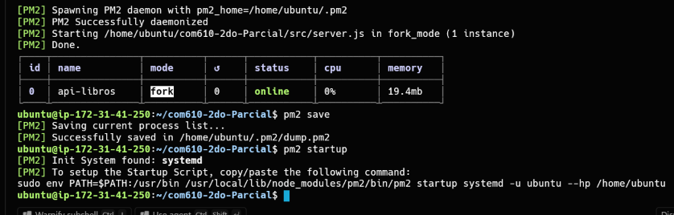

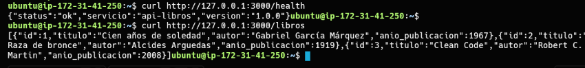

---

## 9. Nginx como proxy inverso (puerto 80)

Archivo `/etc/nginx/sites-available/api-libros`:

```nginx
server {
    listen 80 default_server;
    listen [::]:80 default_server;
    server_name _;

    location / {
        proxy_pass http://127.0.0.1:3000;
        proxy_http_version 1.1;
        proxy_set_header Host $host;
        proxy_set_header X-Real-IP $remote_addr;
        proxy_set_header X-Forwarded-For $proxy_add_x_forwarded_for;
        proxy_set_header X-Forwarded-Proto $scheme;
    }
}
```

```bash
sudo rm /etc/nginx/sites-enabled/default
sudo ln -s /etc/nginx/sites-available/api-libros /etc/nginx/sites-enabled/api-libros
sudo nginx -t
sudo systemctl reload nginx
```

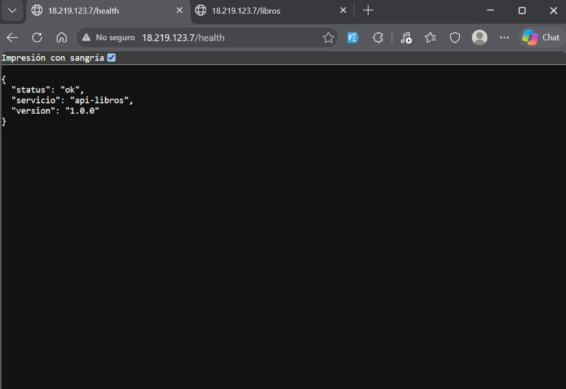

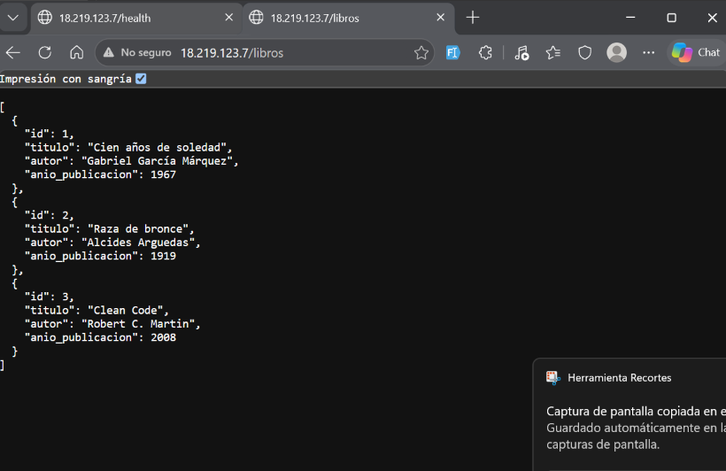

---

## 10. Verificación externa de las operaciones CRUD

Todas las pruebas se hicieron con **Postman** desde mi equipo, contra `http://18.219.123.7`.

### 10.1 Crear — `POST /libros` → `201 Created`

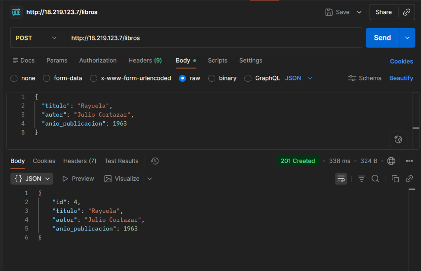

### 10.2 Consultar — `GET /libros/4` → `200 OK`

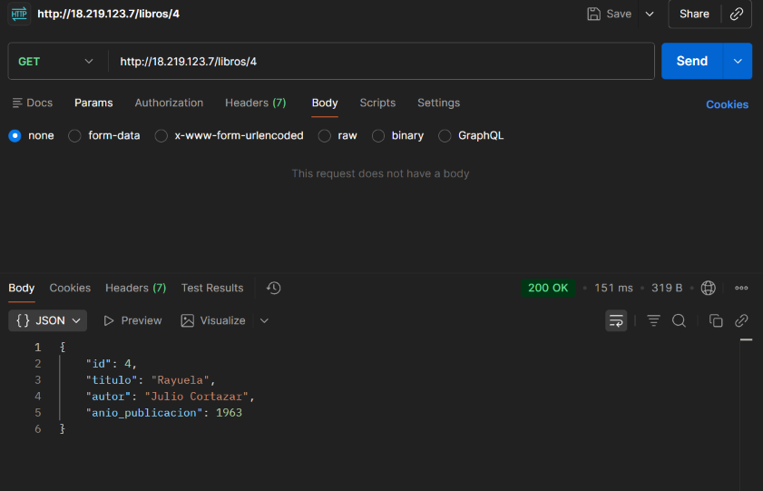

### 10.3 Actualizar — `PUT /libros/4` → `200 OK`

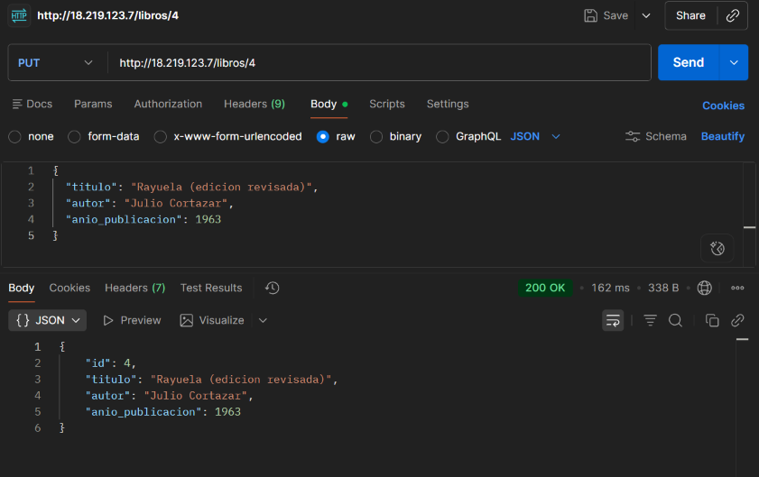

### 10.4 Eliminar — `DELETE /libros/4` → `200 OK`

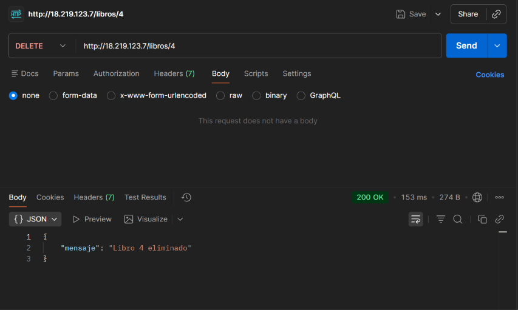

### 10.5 Validaciones y errores

| Prueba | Resultado |
|---|---|
| `POST /libros` con `titulo` vacío y `anio_publicacion: "abc"` | `400 Bad Request` con la lista de errores |
| `GET /libros/4` después de eliminarlo | `404 Not Found` |
| `PUT /libros/9999` | `404 Not Found` |

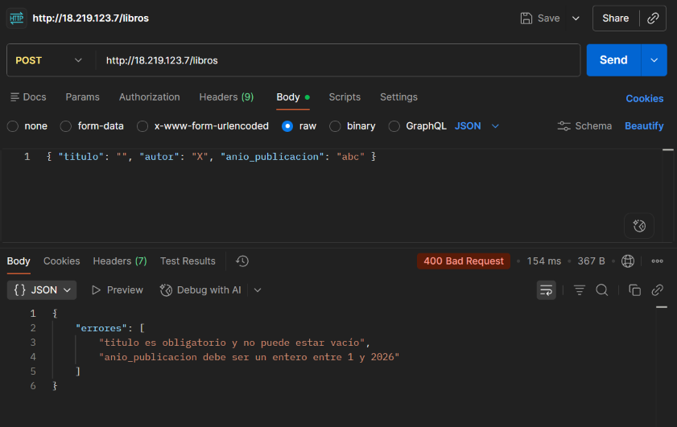

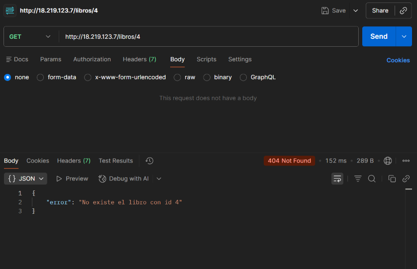

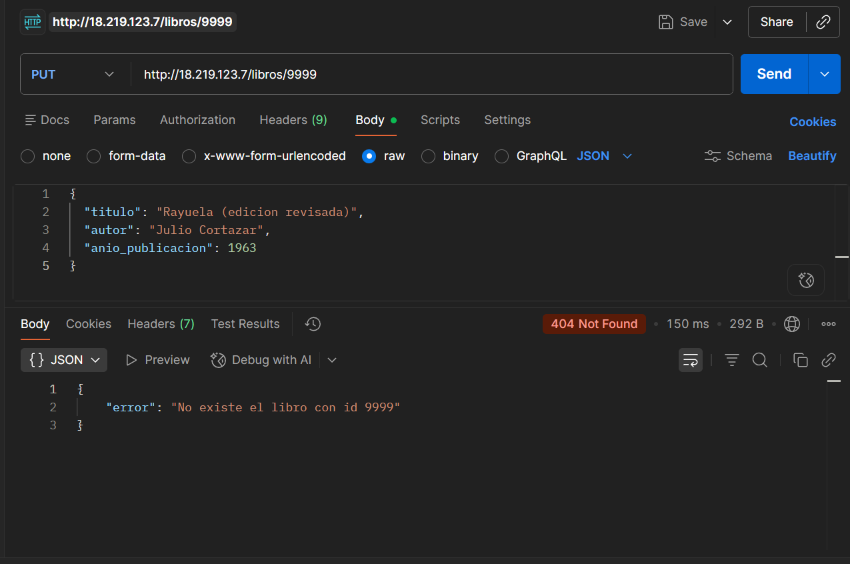

---

## 11. Persistencia en RDS

Para demostrar que los datos se guardan en RDS y no en memoria:

1. Se creó el libro *El principito* (id 5) desde Postman.
2. Se consultó la tabla directamente en RDS: aparece el libro 5 y ya no aparece el 4, que fue eliminado.
3. Se reinició la API con `pm2 restart api-libros` y se volvió a consultar `/libros`. Los datos se mantienen.

```bash
mariadb -h <ENDPOINT_RDS> -u usr_libros -p --ssl-ca=$HOME/certs/global-bundle.pem db_libros -e "SELECT * FROM libros;"
pm2 restart api-libros
curl http://127.0.0.1:3000/libros
```

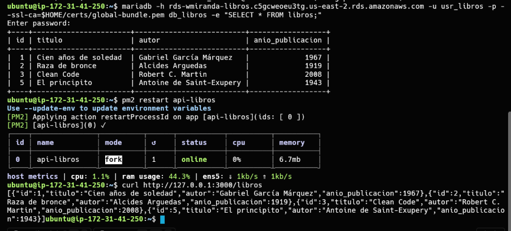

---

## 12. Puertos no expuestos

Al intentar acceder directamente a `http://18.219.123.7:3000/health`, la conexión agota el tiempo de espera (`ERR_TIMED_OUT`), porque el grupo de seguridad no permite el puerto 3000. La API solo es accesible a través de Nginx en el puerto 80. El puerto 3306 tampoco está abierto a Internet, y además RDS no tiene acceso público.

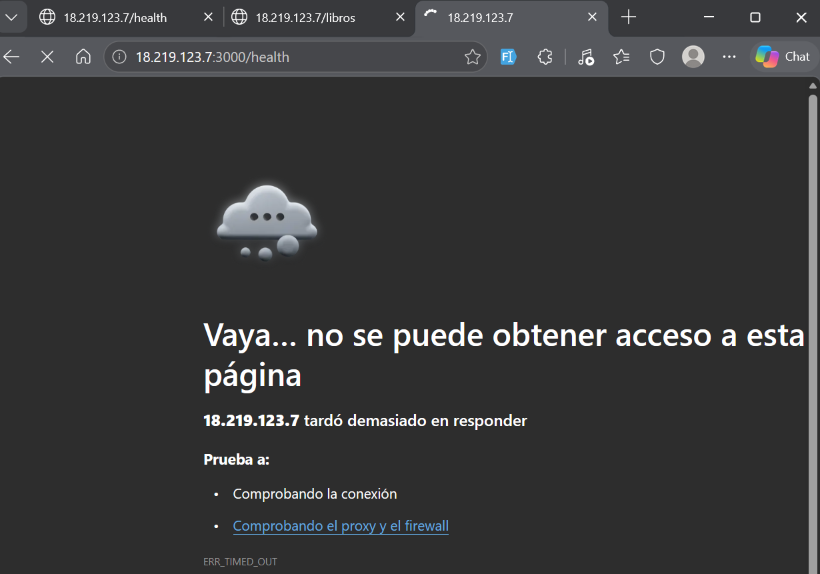

---


## 13. Conclusión

Se desplegó una API REST de libros en una instancia EC2 conectada de forma privada y cifrada a una base de datos RDS for MySQL sin acceso público. Los grupos de seguridad separados limitan el acceso al mínimo necesario: el SSH solo desde mi IP, la web por el puerto 80 a través de Nginx, y la base de datos solo desde la EC2. Las operaciones CRUD se verificaron desde Internet y se comprobó que los datos persisten en RDS aunque la API se reinicie. Las credenciales reales se mantienen fuera del repositorio.
