# Informe — Ejercicio 2: CI/CD para la API de libros

**Universidad San Francisco Xavier de Chuquisaca**
**Materia:** Trabajando en la Nube (COM610)
**Evaluación:** Segundo examen parcial — Tema 5
**Docente:** Ing. Marcelo Quispe Ortega
**Estudiante:** Miranda Pereyra Williams
**GitHub:** [Williams4929](https://github.com/Williams4929)
**Semestre:** 2/2026

---

## 1. Objetivo

Automatizar las comprobaciones y el despliegue de la API de libros del [ejercicio 1](INFORME-EJERCICIO-1.md). Cada cambio que llega a la rama `main`:

1. se prueba;
2. se empaqueta en una imagen Docker identificada con el SHA del commit;
3. se despliega en la misma instancia EC2, sin exponer el puerto 3000 y conservando la versión anterior si la nueva falla.

**URL pública:** `http://18.219.123.7`

| Ejecución | Enlace |
|---|---|
| CI exitoso | https://github.com/Williams4929/com610-2do-Parcial/actions/runs/44622557323 |
| CD exitoso — primer despliegue con Docker | https://github.com/Williams4929/com610-2do-Parcial/actions/runs/44629634021 |
| CD exitoso — versión 1.1.0 (cambio visible) | https://github.com/Williams4929/com610-2do-Parcial/actions/runs/44630408725 |
| CD fallido — se conservó la versión anterior | https://github.com/Williams4929/com610-2do-Parcial/actions/runs/44631286125 |

---

## 2. Flujo completo

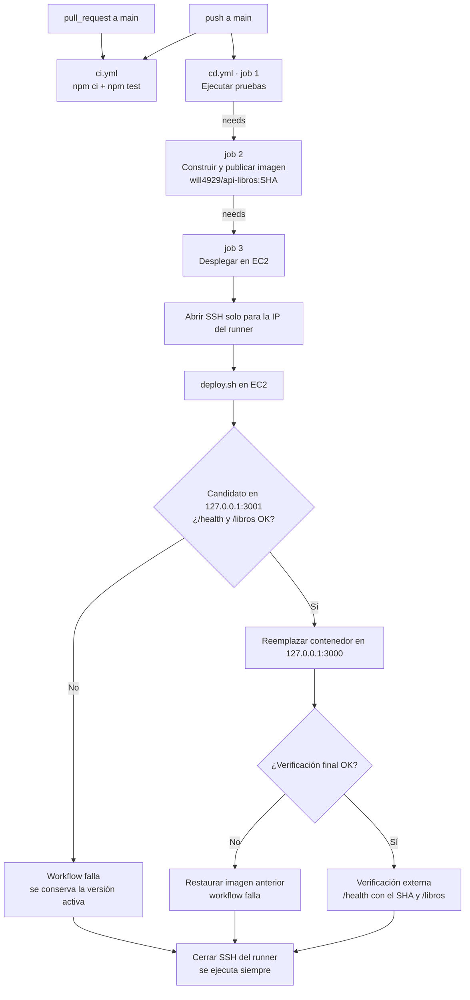

---

## 3. Pruebas automatizadas (Jest + Supertest)

### 3.1 Estrategia sin RDS real

La aplicación se crea con `createApp(repo)`, que recibe la **capa de datos como parámetro**. En producción recibe el repositorio MySQL (`librosRepository.js`). En las pruebas recibe un **doble de prueba**, `crearRepoFalso()`, que guarda los libros en memoria. Así las pruebas se ejecutan sin una instancia RDS.

```js
function crearRepoFalso() {
  let libros = [{ id: 1, titulo: 'Cien años de soledad', autor: 'Gabriel García Márquez', anio_publicacion: 1967 }];
  let siguienteId = 2;
  return {
    listar: async () => libros,
    obtener: async (id) => libros.find((l) => l.id === id) || null,
    crear: async (datos) => { const libro = { id: siguienteId++, ...datos }; libros.push(libro); return libro; },
    // actualizar y eliminar ...
  };
}

beforeEach(() => { app = createApp(crearRepoFalso()); });
```

### 3.2 Casos cubiertos

| Prueba | Esperado | Requerido por el enunciado |
|---|---|---|
| `GET /health` | `200` y `status: ok` | ✅ |
| `GET /libros` | `200` y una lista | — |
| `POST /libros` con datos válidos | `201` con el libro creado | ✅ |
| `POST /libros` con datos inválidos | `400` con errores | ✅ |
| `GET /libros/999` | `404` | ✅ |
| `PUT /libros/999` | `404` | — |
| `DELETE /libros/1` | `200` y luego `404` | — |

En `package.json` se configuró `"test": "jest"`, y `package-lock.json` está en el repositorio.

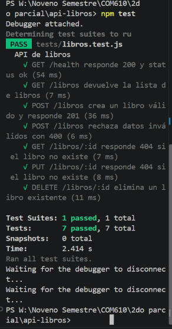

---

## 4. Integración continua — `ci.yml`

```yaml
on:
  push:
    branches: [main]
  pull_request:
    branches: [main]

jobs:
  test:
    runs-on: ubuntu-latest
    steps:
      - uses: actions/checkout@v4
      - uses: actions/setup-node@v4
        with: { node-version: 22, cache: npm }
      - run: npm ci
      - run: npm test
```

Si una prueba falla, `npm test` devuelve un código distinto de cero y la ejecución queda marcada como fallida (ver la [sección 9](#9-pull-request-ci-fallido-y-sin-despliegue)).

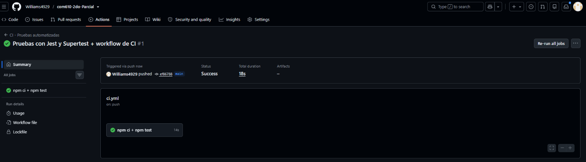

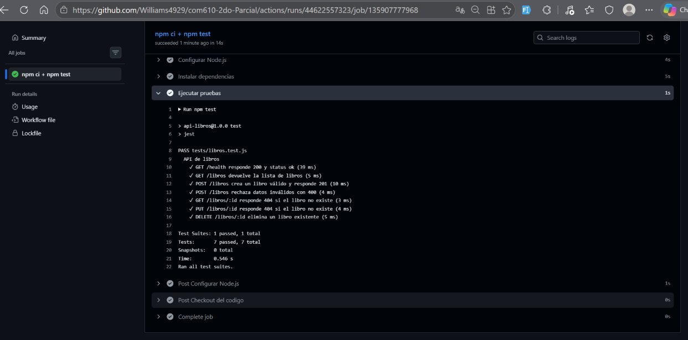

---

## 5. Dockerfile e imagen con configuración externa

```dockerfile
# Etapa 1: dependencias de produccion
FROM node:22-alpine AS deps
WORKDIR /app
COPY package*.json ./
RUN npm ci --omit=dev

# Etapa 2: imagen final
FROM node:22-alpine
WORKDIR /app
ARG GIT_SHA=local
ENV NODE_ENV=production PORT=3000 HOST=0.0.0.0 GIT_SHA=${GIT_SHA}
COPY --from=deps /app/node_modules ./node_modules
COPY package*.json ./
COPY src ./src
USER node
EXPOSE 3000
HEALTHCHECK --interval=30s --timeout=3s --start-period=10s --retries=3 \
  CMD wget -qO- http://127.0.0.1:3000/health || exit 1
CMD ["node", "src/server.js"]
```

Decisiones tomadas:
- **Multi-stage**: la imagen final no lleva Jest ni Supertest.
- Se ejecuta con el usuario **`node`**, sin privilegios de root.
- **`GIT_SHA`** se pasa al construir y se muestra en `/health`, para identificar la versión desplegada.
- La **configuración de RDS no está en la imagen**: llega por variables de entorno. El `.dockerignore` excluye `.env`, `*.pem`, `.git`, `tests` y `evidencias`.

### 5.1 Prueba local

```powershell
docker build --build-arg GIT_SHA=local-test -t api-libros:local .
docker run -d --name api-libros-local -p 3000:3000 -e DB_HOST=... -e DB_USER=... -e DB_PASSWORD=... -e DB_NAME=db_libros api-libros:local
curl.exe http://localhost:3000/health
docker exec api-libros-local printenv DB_HOST DB_NAME
```

El contenedor quedó en estado **healthy**, respondió en `/health` y recibió la configuración por variables de entorno.

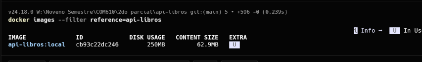

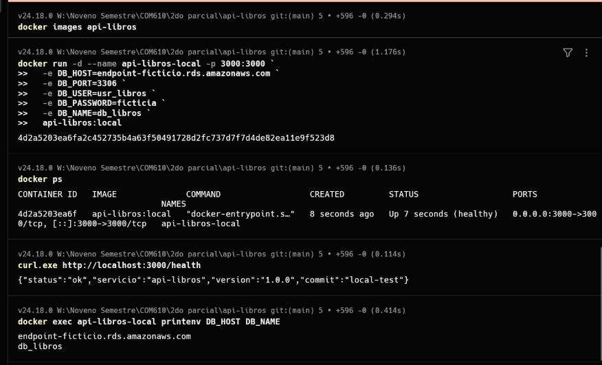

### 5.2 Prueba en EC2 contra el RDS real

En la EC2, la imagen se ejecutó con el archivo de entorno externo y el certificado TLS montado. `/libros` devolvió los datos de RDS:

```bash
docker run -d --name prueba-rds --env-file ~/api-libros.env \
  -e DB_SSL_CA=/certs/global-bundle.pem \
  -v ~/certs/global-bundle.pem:/certs/global-bundle.pem:ro \
  -p 127.0.0.1:3001:3000 api-libros:prueba
```

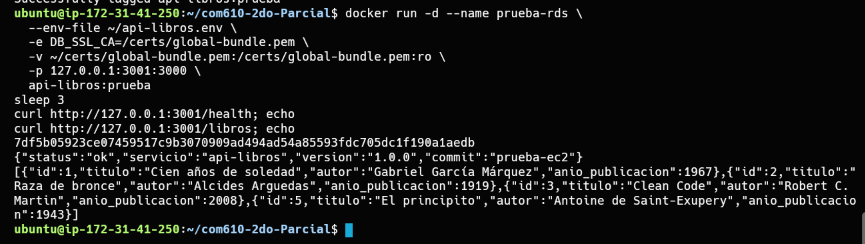

---

## 6. Credenciales y seguridad

### 6.1 Secrets de GitHub Actions

| Secret | Uso |
|---|---|
| `DOCKERHUB_USERNAME`, `DOCKERHUB_TOKEN` | Publicar en Docker Hub (token de acceso, no la contraseña) |
| `EC2_HOST`, `EC2_USER`, `EC2_SSH_KEY` | Conexión SSH a la instancia |
| `EC2_SG_ID` | Grupo de seguridad de la EC2 |
| `AWS_ACCESS_KEY_ID`, `AWS_SECRET_ACCESS_KEY`, `AWS_REGION` | Usuario IAM para el SSH temporal |

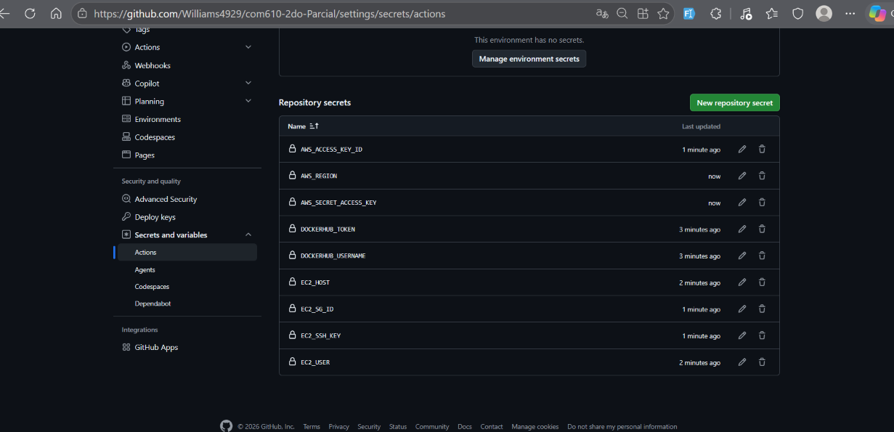

### 6.2 SSH temporal con permiso mínimo

El enunciado exige que la EC2 acepte **SSH solo desde mi IP**. Los runners de GitHub tienen IP variables, por lo que el job de despliegue:

1. obtiene la IP pública del runner;
2. agrega una regla temporal `22/tcp` solo para esa IP (`/32`);
3. despliega;
4. **revoca la regla en un paso con `if: always()`**, de modo que se cierra aunque el despliegue falle.

Para esto se creó el usuario IAM `github-actions-wmiranda`, sin acceso a la consola y con una política que solo permite autorizar y revocar reglas de entrada **en ese grupo de seguridad**:

```json
{
  "Effect": "Allow",
  "Action": ["ec2:AuthorizeSecurityGroupIngress", "ec2:RevokeSecurityGroupIngress"],
  "Resource": "arn:aws:ec2:us-east-2:*:security-group/sg-062f9bdb61702b432"
}
```

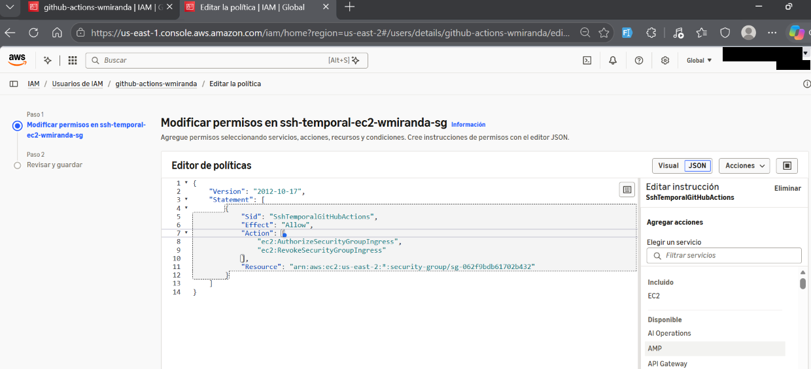

### 6.3 Configuración de RDS fuera del repositorio y de la imagen

En la EC2, los datos de conexión viven en `~/api-libros.env`, con permisos `600`, y el certificado de RDS en `~/certs/global-bundle.pem`. El script de despliegue los entrega al contenedor con `--env-file` y un volumen de solo lectura.

### 6.4 Puerto 3000 no expuesto

El contenedor se publica en **`127.0.0.1:3000`**, no en `0.0.0.0`. Solo Nginx, en el puerto 80 de la misma instancia, puede reenviarle tráfico. Además, el grupo de seguridad no tiene reglas para el puerto 3000.

---

## 7. Despliegue continuo — `cd.yml`

```yaml
on:
  push:
    branches: [main]      # un pull_request NO despliega

jobs:
  test:            # 1) npm ci + npm test
  build-and-push:  # 2) needs: test  -> will4929/api-libros:${{ github.sha }} y :latest
  deploy:          # 3) needs: build-and-push -> SSH temporal + scripts/deploy.sh + verificación
```

### 7.1 Script de despliegue seguro — `scripts/deploy.sh`

1. `docker pull` de la imagen `:SHA`.
2. Guarda la imagen en producción (`PREVIOUS_IMAGE`) para poder restaurarla.
3. Ejecuta la nueva versión como **candidata** en `127.0.0.1:3001` y comprueba **`/health` y `/libros`** (hasta 10 intentos).
4. Si falla: elimina la candidata, **no toca la versión activa** y termina con error (el workflow falla).
5. Si pasa: reemplaza el contenedor `api-libros` en `127.0.0.1:3000` y vuelve a comprobar.
6. Si la verificación final falla: **restaura `PREVIOUS_IMAGE`** y termina con error.

Después, el workflow verifica desde Internet que `/health` muestre el SHA desplegado y que `/libros` responda.

### 7.2 Primer despliegue

Antes del primer despliegue se retiró la API ejecutada con PM2 del ejercicio 1 (`pm2 delete`, `pm2 unstartup`) para liberar el puerto 3000.

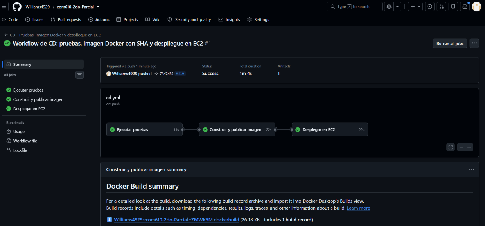

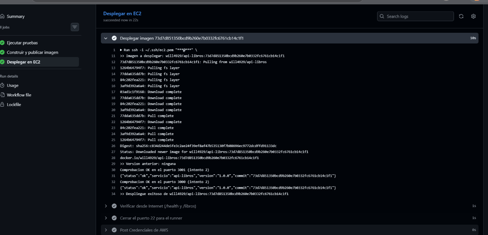

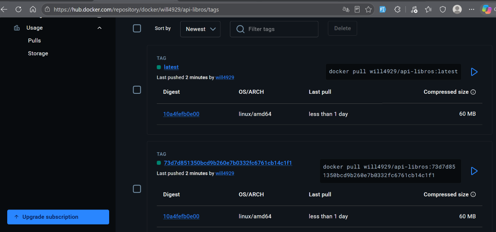

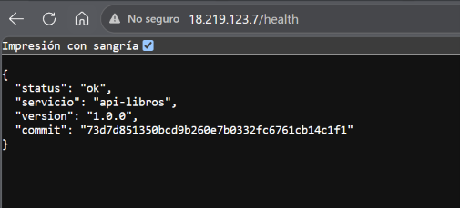

---

## 8. Verificación del despliegue y conservación de la versión anterior

### 8.1 Cambio visible: versión 1.1.0

Se cambió la versión en `package.json` a **1.1.0** y se hizo push a `main`. El CD #2 desplegó la imagen `bec9e5e...` y `/health` pasó a mostrar la nueva versión y el nuevo commit.

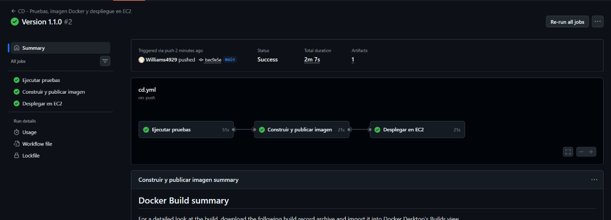

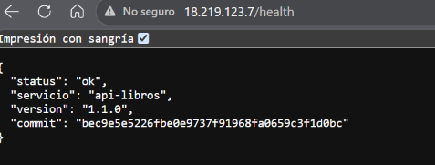

### 8.2 Versión defectuosa: el workflow falla y se conserva la anterior

Se introdujo a propósito un error que **las pruebas no detectan**, porque usan el doble de prueba, pero que **falla en producción**: `listar()` consultaba la tabla inexistente `libros_error`.

- **Ejecutar pruebas** ✅ y **Construir y publicar imagen** ✅.
- **Desplegar en EC2** ❌: el candidato respondió `500` en `/libros` (`ER_NO_SUCH_TABLE`), y el script lo descartó.
- La versión **1.1.0 (`bec9e5e`) siguió en producción**, y `/libros` siguió funcionando.
- El paso que cierra el SSH temporal se ejecutó igualmente.

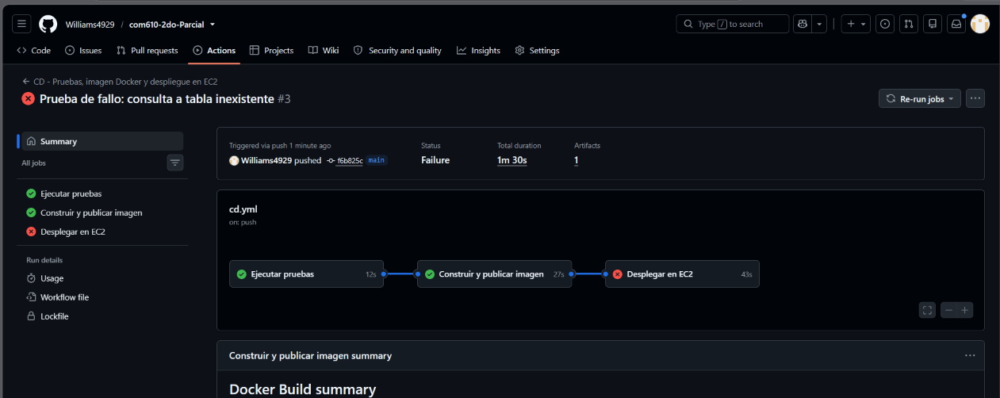

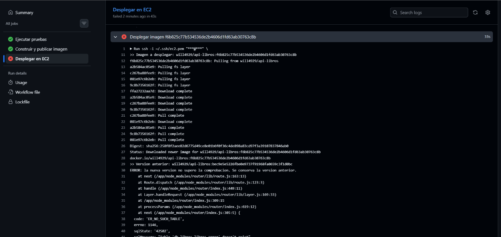

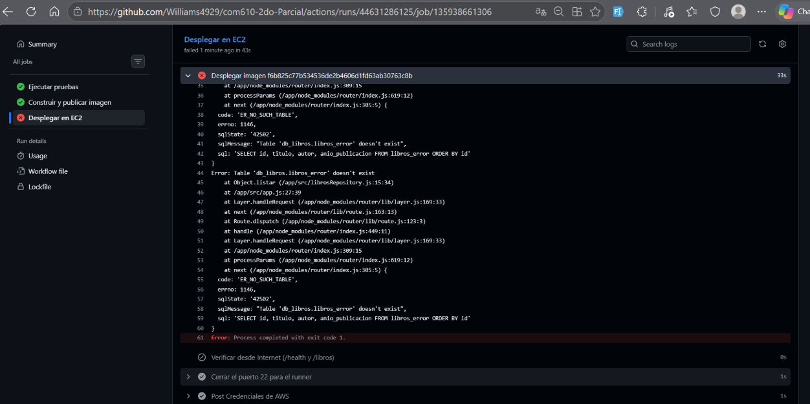

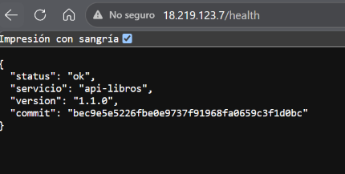

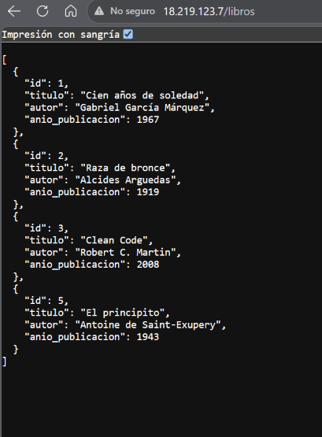

El error se corrigió con `git revert`, y el CD #4 volvió a desplegar correctamente:

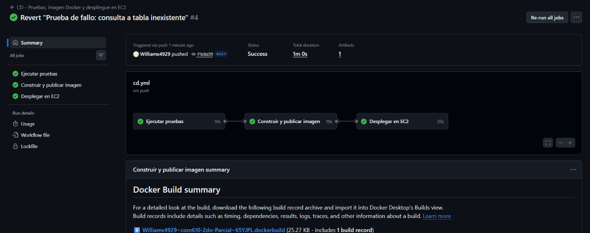

| CD | Commit | Resultado |
|---|---|---|
| #1 | `73d7d85` | ✅ Primer despliegue con Docker |
| #2 | `bec9e5e` | ✅ Versión 1.1.0 (cambio visible) |
| #3 | `f6b825c` | ❌ Comprobación fallida; se conservó `bec9e5e` |
| #4 | `f1b8d39` | ✅ Revert desplegado |

### 8.3 Rollback manual

Como cada imagen está etiquetada con el SHA de su commit, se puede volver a cualquier versión publicada ejecutando el mismo script en EC2:

```bash
IMAGE=will4929/api-libros:<SHA_ANTERIOR> bash scripts/deploy.sh
```

---

## 9. Pull request: CI fallido y sin despliegue

Se creó la rama `prueba-pr` con un cambio que rompe `/health` (`status: 'caido'`) y se abrió el pull request #1 hacia `main`:

- **CI** se ejecutó por `pull_request` y quedó **en rojo**: *GET /health responde 200 y status ok* esperaba `"ok"` y recibió `"caido"` (1 fallida, 6 aprobadas).
- **CD no se ejecutó**, porque solo responde a `push` en `main`. Producción siguió en `f1b8d39`.
- El PR se cerró **sin fusionar** y se eliminó la rama.

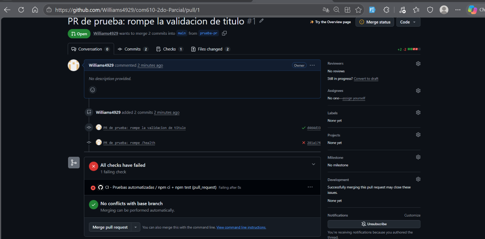

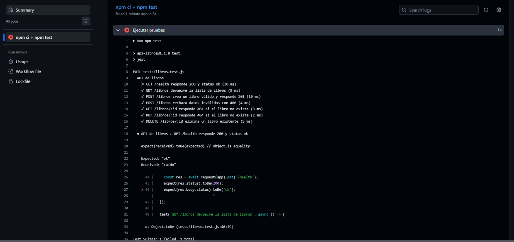

---


## 10. Conclusión

El pipeline automatiza el ciclo completo de la API: cada cambio en `main` se prueba, se empaqueta en una imagen identificada con el SHA de su commit y se despliega en EC2 solo si las pruebas pasan. El despliegue prueba primero la nueva versión en un puerto aislado y solo entonces reemplaza a la activa. La prueba con una versión defectuosa demostró que el workflow falla sin afectar a los usuarios.

Las credenciales se gestionan como secrets, el acceso SSH del pipeline es temporal y limitado a la IP del runner, la configuración de la base de datos vive solo en la instancia y la API sigue accesible únicamente a través de Nginx.
