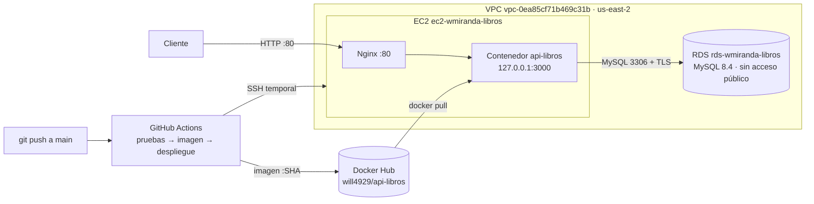

# API REST de libros — EC2 + RDS + CI/CD con GitHub Actions

Segundo examen parcial de **Trabajando en la Nube (COM610)**, Universidad San Francisco Xavier de Chuquisaca, semestre 2/2026.

**Estudiante:** Miranda Pereyra Williams · GitHub: [Williams4929](https://github.com/Williams4929)

## Enlaces de la entrega

| Recurso | Enlace |
|---|---|
| **URL pública de la API** | **http://18.219.123.7** |
| Estado del servicio | http://18.219.123.7/health |
| Lista de libros | http://18.219.123.7/libros |
| **Ejecución exitosa de CI** | https://github.com/Williams4929/com610-2do-Parcial/actions/runs/44622557323 |
| **Ejecución exitosa de CD** (despliegue de la versión 1.1.0) | https://github.com/Williams4929/com610-2do-Parcial/actions/runs/44630408725 |
| Primer despliegue exitoso de CD | https://github.com/Williams4929/com610-2do-Parcial/actions/runs/44629634021 |
| CD fallido que conservó la versión anterior | https://github.com/Williams4929/com610-2do-Parcial/actions/runs/44631286125 |
| Imagen en Docker Hub | https://hub.docker.com/r/will4929/api-libros/tags |
| Informe del ejercicio 1 (EC2 + RDS) | [INFORME-EJERCICIO-1.md](INFORME-EJERCICIO-1.md) |
| Informe del ejercicio 2 (CI/CD) | [INFORME-EJERCICIO-2.md](INFORME-EJERCICIO-2.md) |
| Evidencias (capturas) | [evidencias/](evidencias/) |

> Si la IP pública de la instancia cambiara, esta tabla se actualizará con la nueva URL. La instancia usa una Elastic IP, por lo que la dirección es estable.

---

## Arquitectura



## Endpoints

| Método y ruta | Respuesta |
|---|---|
| `GET /health` | `200` `{"status":"ok","servicio":"api-libros","version":"1.1.0","commit":"<sha>"}` |
| `GET /libros` | `200` con la lista de libros almacenados en RDS |
| `GET /libros/:id` | `200` con el libro · `404` si no existe |
| `POST /libros` | `201` con el libro creado · `400` si los datos no son válidos |
| `PUT /libros/:id` | `200` con el libro actualizado · `404` si no existe · `400` si los datos no son válidos |
| `DELETE /libros/:id` | `200` `{"mensaje":"Libro N eliminado"}` · `404` si no existe |

**Validaciones:** `titulo` y `autor` son obligatorios y no pueden estar vacíos; `anio_publicacion` debe ser un entero entre 1 y el año actual. Todas las consultas SQL son parametrizadas.

Ejemplo:

```bash
curl -X POST http://18.219.123.7/libros \
  -H "Content-Type: application/json" \
  -d '{"titulo":"Rayuela","autor":"Julio Cortazar","anio_publicacion":1963}'
```

---

## Recursos de AWS utilizados

Región **us-east-2 (Ohio)**. Todos los recursos están en la misma VPC y se identifican con `wmiranda`.

| Recurso | Nombre / ID | Configuración |
|---|---|---|
| EC2 | `ec2-wmiranda-libros` | Ubuntu 26.04 LTS, `t3.micro`, Nginx + Docker |
| Elastic IP | `18.219.123.7` | Asociada a la EC2 |
| RDS | `rds-wmiranda-libros` | MySQL 8.4, `db.t4g.micro`, **acceso público deshabilitado** |
| Grupo de seguridad EC2 | `ec2-wmiranda-sg` (`sg-062f9bdb61702b432`) | SSH 22 solo desde mi IP · HTTP 80 desde Internet |
| Grupo de seguridad RDS | `rds-wmiranda-sg` (`sg-0cd093a9054a2d05f`) | MySQL 3306 solo desde `ec2-wmiranda-sg` |
| Usuario IAM | `github-actions-wmiranda` | Solo puede autorizar o revocar reglas de entrada en `ec2-wmiranda-sg` (SSH temporal del despliegue) |

Los puertos **3000** y **3306** no están abiertos a Internet: la API solo es accesible a través de Nginx.

---

## Estructura del repositorio

```
src/
  app.js               Rutas, códigos HTTP y manejo de errores (createApp(repo))
  validacion.js        Validación de los datos del libro
  librosRepository.js  Capa de datos: consultas SQL parametrizadas
  db.js                Pool mysql2 configurado por variables de entorno (TLS opcional)
  server.js            Punto de entrada
tests/libros.test.js   Pruebas con Jest + Supertest (doble de prueba de la capa de datos)
db.sql                 Creación de la base, la tabla libros y datos iniciales
Dockerfile             Imagen multi-stage de la API
.dockerignore
scripts/deploy.sh      Despliegue seguro en EC2 con verificación y restauración
.github/workflows/
  ci.yml               npm ci + npm test en push y pull_request a main
  cd.yml               pruebas → imagen Docker :SHA → despliegue en EC2 (solo push a main)
.env.example           Variables de entorno con valores ficticios
evidencias/            Capturas de ambos ejercicios
```

---

## Ejecutar la aplicación localmente

Requisitos: Node.js 18 o superior y una base MySQL/MariaDB accesible.
La base RDS del proyecto no es accesible desde Internet.

```bash
npm ci
cp .env.example .env      # completar con los datos reales de la base
mysql -h <host> -u <usuario> -p < db.sql
npm start
curl http://localhost:3000/health
```

Variables de entorno (`.env.example`):

| Variable | Descripción |
|---|---|
| `PORT` | Puerto de la API (por defecto 3000) |
| `HOST` | Interfaz de escucha (`127.0.0.1` detrás de Nginx, `0.0.0.0` en Docker) |
| `DB_HOST`, `DB_PORT` | Endpoint y puerto de RDS |
| `DB_USER`, `DB_PASSWORD` | Usuario de la API (`usr_libros`) y su contraseña |
| `DB_NAME` | `db_libros` |
| `DB_SSL_CA` | Ruta del certificado de AWS RDS para la conexión TLS |

El archivo `.env`, las claves `.pem`, los tokens y las contraseñas reales **no se publican** en el repositorio (`.gitignore`).

## Ejecutar las pruebas

```bash
npm ci
npm test
```

Las 7 pruebas usan un **doble de prueba de la capa de datos** (un repositorio en memoria inyectado en `createApp(repo)`), por lo que **no necesitan una instancia RDS real**. Cubren `GET /health`, la lista de libros, la creación válida (`201`), el rechazo de datos inválidos (`400`), el `404` de un libro inexistente (`GET` y `PUT`) y la eliminación.

## Ejecutar con Docker

```bash
docker build --build-arg GIT_SHA=local -t api-libros:local .
docker run -d --name api-libros -p 3000:3000 \
  -e DB_HOST=<endpoint> -e DB_PORT=3306 -e DB_USER=usr_libros \
  -e DB_PASSWORD=<contraseña> -e DB_NAME=db_libros \
  api-libros:local
curl http://localhost:3000/health
```

La configuración de RDS **no** forma parte de la imagen: se entrega al contenedor mediante variables de entorno.

---

## CI/CD con GitHub Actions

### CI — `.github/workflows/ci.yml`

Se ejecuta en cada `push` y `pull_request` hacia `main`: `npm ci` y `npm test`. Si una prueba falla, la ejecución queda marcada como fallida.

### CD — `.github/workflows/cd.yml`

Se ejecuta **solo** con `push` a `main` (un `pull_request` no despliega). Tiene tres trabajos dependientes:

1. **Ejecutar pruebas**: `npm ci` y `npm test`.
2. **Construir y publicar imagen** (`needs: test`): publica `will4929/api-libros:<SHA del commit>` (y `latest`) en Docker Hub.
3. **Desplegar en EC2** (`needs: build-and-push`):
   - Abre temporalmente el puerto 22 solo para la IP del runner (el SSH normalmente solo acepta mi IP) y lo cierra al final, aunque el despliegue falle.
   - Ejecuta `scripts/deploy.sh` en EC2: prueba la imagen nueva en `127.0.0.1:3001` verificando `/health` y `/libros`. Si pasa, reemplaza al contenedor activo en `127.0.0.1:3000` y vuelve a verificar. **Si la nueva versión no supera la comprobación, el workflow falla y se conserva o restaura la versión anterior.**
   - Verifica desde Internet `/health` (que debe mostrar el SHA desplegado) y `/libros`.

### Secrets de GitHub Actions

| Secret | Uso |
|---|---|
| `DOCKERHUB_USERNAME`, `DOCKERHUB_TOKEN` | Publicar la imagen en Docker Hub |
| `EC2_HOST`, `EC2_USER`, `EC2_SSH_KEY` | Conexión SSH a la instancia |
| `EC2_SG_ID` | Grupo de seguridad donde se abre el SSH temporal |
| `AWS_ACCESS_KEY_ID`, `AWS_SECRET_ACCESS_KEY`, `AWS_REGION` | Usuario IAM con permiso mínimo sobre ese grupo |

En EC2, la configuración de RDS vive en `~/api-libros.env` (permisos `600`), fuera del repositorio y de la imagen. El certificado de RDS se monta como volumen de solo lectura.

---

## Cómo verificar el despliegue

1. `curl http://18.219.123.7/health` → `200`, `"status":"ok"`, con `version` y `commit` iguales a los del último CD exitoso.
2. `curl http://18.219.123.7/libros` → lista de libros leída de RDS.
3. Crear, consultar, actualizar y eliminar un libro con los ejemplos de la sección [Endpoints](#endpoints).
4. `http://18.219.123.7:3000/health` **no** responde (el puerto 3000 no está expuesto).
5. En EC2: `docker ps` muestra `api-libros` publicado en `127.0.0.1:3000->3000/tcp`.

**Rollback manual** a una versión anterior (las imágenes están etiquetadas con el SHA). En EC2, dentro del repositorio clonado:

```bash
cd ~/com610-2do-Parcial && git pull
IMAGE=will4929/api-libros:<SHA_ANTERIOR> bash scripts/deploy.sh
```

---

## Evidencias

Todas las capturas están en [`evidencias/`](evidencias/) y se explican en los informes:

- **Ejercicio 1** (`01` a `14`): EC2 y sus reglas de seguridad, RDS sin acceso público y su regla de entrada, conexión EC2 → RDS, operaciones CRUD, validaciones, persistencia y puerto 3000 cerrado.
- **Ejercicio 2** (`15` en adelante): ejecución de las pruebas, CI, imagen Docker local y en EC2, política IAM, secrets, imagen publicada en Docker Hub, despliegues exitosos, despliegue fallido con conservación de la versión anterior y pull request con CI fallido y sin despliegue.
